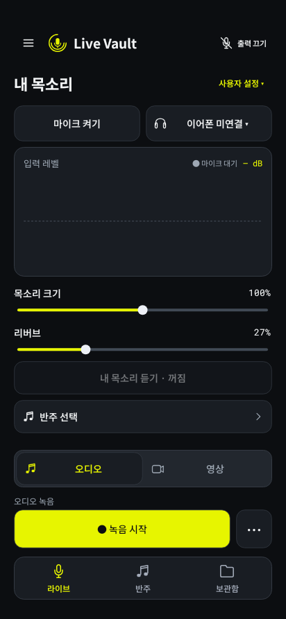
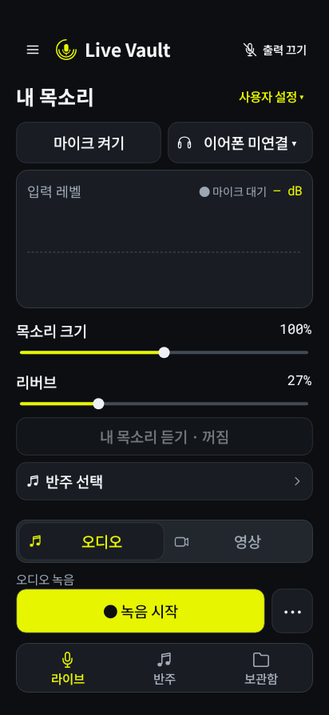
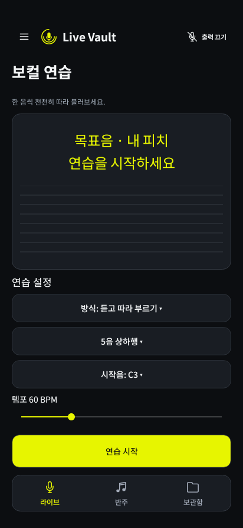

# Live Vault 2.3 — Galaxy S26 Ultra 배치

사용자가 지정한 Galaxy S26 Ultra에 맞춰 2.2의 색상·로고·세 개 하단 메뉴를 유지하고 화면 비율과 조작 위치를 조정했다.

## 배치 기준

[삼성 제품 사양](https://www.samsung.com/uk/business/smartphones/galaxy-s/galaxy-s26-ultra-cobalt-violet-256gb-sm-s948bzvdeub/)의 3120 × 1440 비율을 참고했다. Android의 실제 dp 크기는 해상도·화면 확대 설정에 따라 달라지므로 제품명을 조건문으로 검사하거나 픽셀 크기를 고정하지 않는다. 앱이 측정한 창 크기와 시스템 inset을 기준으로 배치한다.

- 좌우 여백은 일반적인 S26 Ultra 창에서 20dp이며 좁은 창은 16dp로 조정한다. 넓은 창에서는 콘텐츠가 480dp를 넘게 늘어나지 않도록 가운데에 둔다.
- 라이브는 내 목소리/프리셋 → 마이크/출력 → 입력 파형 → 목소리·리버브 → 모니터링 → 반주 순서다. 남는 높이는 파형에 배분하고 짧은 창은 본문을 스크롤한다.
- 오디오/영상 선택, 녹음 상태·시간, 녹음 버튼을 하단 메뉴 위에 고정했다. 녹음이 시작돼도 버튼 위치는 유지된다.
- 영상의 촬영·일시정지와 보컬 연습의 시작·종료도 본문 스크롤과 분리했다. 카메라 미리보기는 실제 남은 공간을 사용한다.
- 상태 표시줄·카메라 구멍·제스처/3버튼 탐색 영역·키보드가 차지하는 공간을 반영한다. 녹음 중 창 크기가 바뀌어도 화면을 새로 만들어 오디오나 카메라를 재시작하지 않는다.
- 슬라이더의 글자와 높이는 글자 크기를 따른다. 전체 메뉴는 스크롤되며, 선택창은 실제 창과 글자 높이 안에서 목록 길이를 정한다.

## 실제 코드 렌더링

아래는 현재 앱의 Java View·Canvas·VectorDrawable을 Android 프레임워크와 네이티브 Skia로 렌더링한 결과다. 휴대폰 실기기 스크린샷은 아니다. 오디오 장치 호출은 테스트 대체를 사용하며 샘플 데이터는 APK에 포함되지 않는다.

| 기본 글자 크기 | 130% 글자 크기 | 보컬 연습 |
| --- | --- | --- |
|  |  |  |

[전체 메뉴](screenshots/v2.3/s26u-default-drawer.png)

412 × 893dp의 전체 창, 상단 36dp와 제스처 하단 24dp를 사용한 시뮬레이션이다. 이는 기기의 실제 dp/inset을 측정한 값이 아니며 앱에서는 런타임 값을 사용한다. 화면의 검은 위/아래 영역은 시스템 UI에 양보한 공간이며 시스템 아이콘은 렌더링하지 않는다.

## 확인 범위

API 28의 360/412 너비와 API 35의 S26 Ultra 비율을 검사한다. 기본/130% 글씨, 하단 24/48dp, 키보드 300dp와 녹음 상태 전환을 재현해 고정 버튼과 하단 메뉴가 시스템 영역과 겹치지 않는지 확인한다. 본문을 스크롤한 뒤 녹음·연습·영상 조작 위치가 유지되는지, 기존 선택창·슬라이더·반주 seek 조작도 함께 검사한다.

```sh
./gradlew :app:testStandardDebugUnitTest --tests pro.livemic.studio.StudioScreenshotTest
```

렌더링 결과는 `app/build/studio-screenshots/`에 저장한다. 2.3은 오디오 DSP·라우팅·녹음 포맷을 변경하지 않는다. 실제 S26 Ultra에서의 터치감·음향·카메라 품질과 One UI의 모든 화면 확대 조합은 별도 검증이 필요하다.
