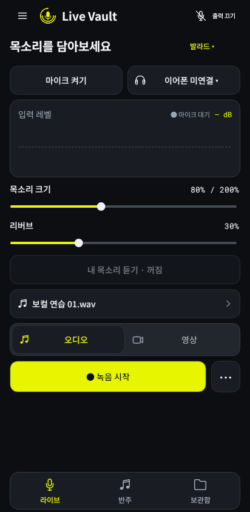
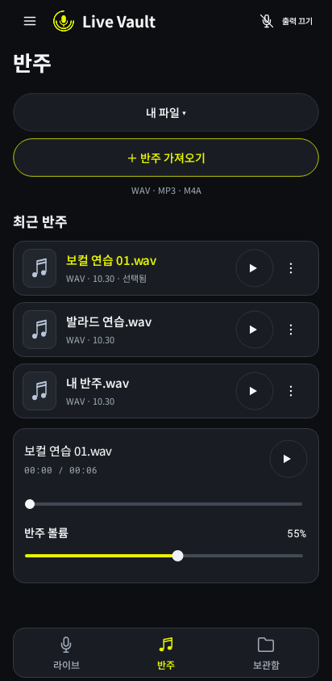
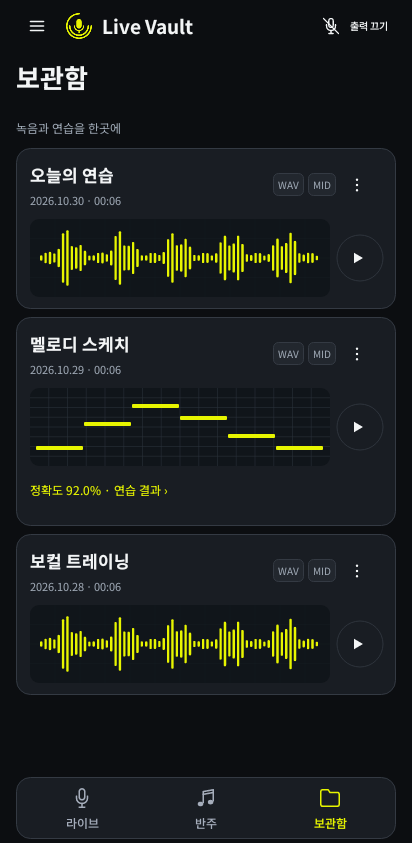
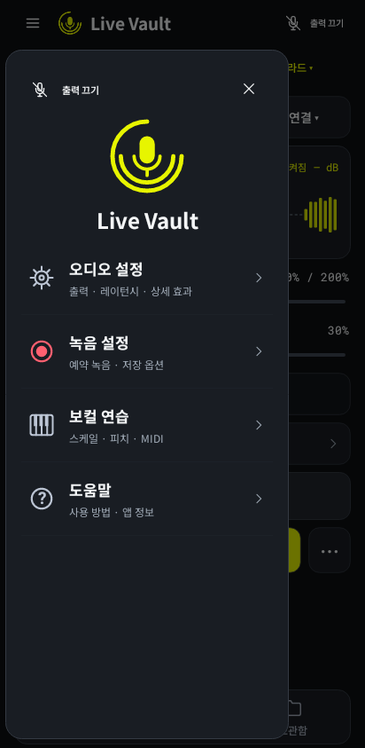

# Live Vault 2.2 UI 변경

이 문서는 2.2 디자인 이력이다. [현재 2.3 배치와 APK 검증](GALAXY_S26_ULTRA_LAYOUT.md)을 확인하세요.

사용자 커밋 `3671ab0`의 리디자인을 통합했다. 라이브 화면에서 마이크 전원, 출력 장치, 내 목소리 모니터링과 녹음 중 상태를 구분한다. 실시간 입력 레벨과 조절값 단위를 표시하며 녹음 시작과 종료·저장 버튼을 상태에 따라 구분한다. 하단 탐색은 요청대로 **라이브·반주·보관함 3개**이며 보컬 연습은 **전체 메뉴 → 보컬 연습**에서 연다.

앱 내부의 프리셋, 출력·입력 장치, 반주 소스·스타일, 연습 방식·음계·시작음과 테이크 메뉴는 공통 선택 시트를 사용한다. 선택 항목과 파괴적인 동작을 색상과 문구로 표시한다. 녹음·출력 설정과 확인창은 공통 다크 테마를 사용한다. Android의 권한창, 문서 선택기, 공유 화면과 외부 앱은 OS 또는 해당 앱에서 표시한다.

보관함에서 재생 중인 테이크와 시간을 표시하고 일시정지·재개 및 다른 테이크로 전환할 수 있다. 실제 존재하는 파일 형식에 해당하는 메뉴만 보여준다. 로컬 반주 재생 위치는 드래그 또는 접근성 조작으로 변경할 수 있으며 예약·녹음 중에는 변경하지 않는다.

승인된 이중 원호 마이크 [SVG](../design/brand/live-vault-mark.svg)와 Android VectorDrawable은 변경하지 않았다.

## 실제 앱 코드 렌더링

Android API 28 프레임워크와 네이티브 Skia로 **현재 Java View·Canvas·VectorDrawable 코드**를 렌더링했다. Robolectric에서 오디오 장치 호출을 대체했으며 표시된 파일·파형은 시각검사용 샘플이다. 실기기 캡처나 실제 발성 측정 결과를 뜻하지 않는다. 테스트 데이터는 APK에 포함되지 않는다.

| 라이브 | 반주 | 보관함 | 전체 메뉴 |
| --- | --- | --- | --- |
|  |  |  |  |

[샘플 입력 파형 상태](screenshots/v2.2/live-fixture.png) · [전체 메뉴 안의 보컬 연습](screenshots/v2.2/practice.png)

이미지는 412 × 843 앱 영역이다. 상태 표시줄과 시스템 탐색 영역은 제외했으며 360 × 728 앱 영역도 같은 검사에서 확인했다.

## 디자인 참고

[핵심 6개 화면](../design/redesign/LiveVault_redesign_board.svg)과 [선택 화면: 출력·효과·녹음](../design/redesign/LiveVault_options_board_1.svg), [장치·보컬 연습](../design/redesign/LiveVault_options_board_2.svg), [반주·파일](../design/redesign/LiveVault_options_board_3.svg), [확인창·연습 결과](../design/redesign/LiveVault_options_board_4.svg)는 편집 가능한 SVG 시안이다. 실제 앱 화면 캡처가 아니며, 앱 구현과 일부 배치·동작은 다르다. 예시 음원·시간·파형·점수는 실제 측정값이 아니다.

SVG 원본의 4탭 시안은 디자인 이력으로 보관한다. 현재 앱은 위 렌더링과 같이 3탭을 사용한다.

기존 Figma 파일은 연동 호출 한도와 브라우저 접속 문제로 수정하지 못했다. 화면별 SVG를 Figma에 직접 가져올 수 있다. 원본 앱 글꼴은 Noto Sans KR과 Roboto Mono이며 가져오는 환경에 따라 글꼴 대체가 발생할 수 있다.

## 검증 범위

2.2.0-preview / versionCode 7의 standard/personal debug APK를 빌드했다. 현재 공개 APK는 2.3으로 갱신됐으며 이 문서의 PNG는 2.2 이력이다. 개인용은 비공개로 전달한다. 기존 개발 서명·앱 ID·보관함 경로를 유지한다.

- Robolectric의 테스트 오디오 클래스에 `@DoNotInstrument`를 적용해 `__staticInitializer__` 중복 오류를 수정했다. 화면·선택 시트 검사 두 개가 통과한다.
- 360/412 너비에서 대기/녹음 중 녹음 버튼이 하단 메뉴 위에 남는지, 하단 메뉴가 3개인지, 전체 메뉴에서 연습으로 이동하는지 확인했다.
- 선택 시트의 선택 표시·실제 클릭, 슬라이더와 반주 구간 이동의 접근성 조작/값 전달, 비활성 구간 이동과 MIDI 노트 읽기를 확인했다.
- 기존 DSP·피드백 보호·캡처 버스·예약 녹음·보컬 채점·녹음 싱크와 추가된 로컬 seek 경계/무효값/최신 요청/초기화 호스트 검사가 통과했다.
- APK 서명·버전·3개 ABI·벡터 포함, 일반용의 개인 캡처 구현/권한 제외 및 테스트 코드·샘플 데이터 미포함을 확인했다.

```sh
./gradlew :app:testStandardDebugUnitTest --tests pro.livemic.studio.StudioScreenshotTest :app:assembleStandardDebug
./scripts/test-native.sh
./scripts/test-schedule.sh
./scripts/test-v2.sh
```

실제 기기의 마이크/카메라 품질, Bluetooth 왕복 지연·하울링 억제와 확대 글꼴 검증은 남아 있다. 이 문서의 뷰 렌더링은 그 검증을 대체하지 않는다.
