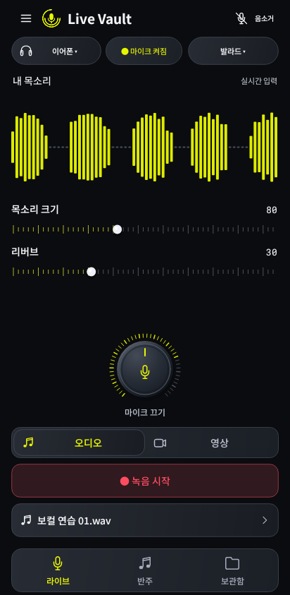
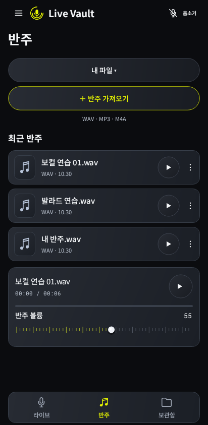
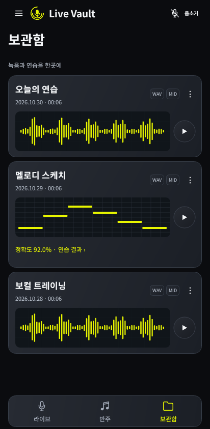
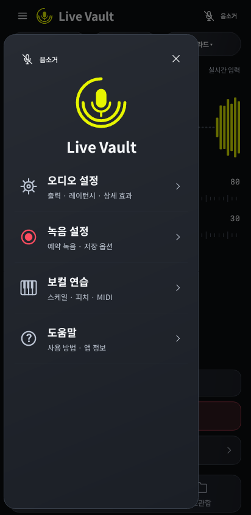

# Live Vault 2.1 화면

이 문서는 2.1 화면 이력이다. [현재 2.2 화면](REDESIGN_2026.md)을 확인하세요.

승인된 블랙·차콜·네온 옐로 시안을 바탕으로 네이티브 화면을 다시 구성했다. 로고는 사용자가 선택한 이중 원호 마이크를 그대로 사용한다. [SVG 원본](../design/brand/live-vault-mark.svg) · [Android 벡터](../app/src/main/res/drawable/live_vault_mark.xml)

## 실제 코드의 렌더링

아래 이미지는 앱의 Java View·VectorDrawable·Canvas 코드를 Android API 28 프레임워크와 네이티브 Skia로 그린 결과다. Robolectric에서 오디오 하드웨어 호출만 대체했다. **파형·파일·점수는 시각검사용 샘플 데이터**이며, 실제 마이크 녹음이나 실기기 캡처 결과를 뜻하지 않는다. 설치한 앱은 샘플 테이크를 생성하지 않는다.

412 × 843 앱 영역이며 상태 표시줄·시스템 내비게이션은 제외했다. 360 × 728 앱 영역도 같은 검사에서 렌더링한다.

| 라이브 | 반주 | 보관함 | 전체 메뉴 |
| --- | --- | --- | --- |
|  |  |  |  |

[마이크를 켜기 전의 실제 대기 화면](screenshots/v2.1/live-idle.png)

## 적용 내용

- 상단에는 원호 로고·앱 이름·전체 메뉴·긴급 음소거를 배치했다. 하단은 아이콘과 이름이 있는 라이브·반주·보관함 세 개다.
- 라이브는 외곽 카드 없이 입력 파형, 눈금형 목소리 크기·리버브, 금속 질감의 마이크 다이얼을 배치했다. 다이얼은 마이크 시작/종료 버튼이다. 오디오/영상 선택과 녹음·반주 이동은 아래에 모았다.
- 반주는 최근 파일의 이름·형식·날짜와 재생/메뉴를 표시한다. 선택한 반주는 시간·재생 진행선·볼륨이 있는 미니 플레이어에 모았다.
- 보관함은 한 테이크 안에 실제 존재하는 WAV/MID/MP4 형식과 조작 메뉴를 묶는다. WAV에서 읽은 파형, 보컬 연습 MIDI의 노트, 영상의 첫 프레임을 미리보기로 사용한다.
- 전체 메뉴는 오디오 설정·녹음 설정·보컬 연습·도움말 네 항목이다. 레이턴시·싱크·상세 효과와 예약 녹음, 스케일/피치/MIDI 기능은 이 안에서 연다.
- 카드에는 얇은 경계와 차콜 그라디언트를 사용하고 숫자는 Roboto Mono, 본문은 Noto Sans KR을 유지했다. [디자인 토큰](design-tokens.json)에 실제 색상을 반영했다.

## 검증

`StudioScreenshotTest`는 실제 화면을 그리면서 360/412 너비에서 녹음 버튼이 하단 탭 위에 남는지 확인한다. 슬라이더의 접근성 조절이 실제 파라미터 값으로 전달되는지와 저장 MIDI의 노트 읽기도 확인한다. 화면마다 레이아웃과 드로잉을 새로 계산한다.

```sh
./gradlew :app:testStandardDebugUnitTest --tests pro.livemic.studio.StudioScreenshotTest
```

출력: `app/build/studio-screenshots/`. 테스트 데이터는 `src/test`에만 있으며 APK에는 포함되지 않는다.

standard/personal APK 빌드, 기존 DSP·예약 녹음·보컬 채점·녹음 싱크 검사, 서명 유지와 개인용 코드 분리를 확인했다. 이 UI 갱신에서 오디오 엔진에 추가한 것은 로컬 반주의 재생 위치/전체 길이 조회다.

실제 기기의 오디오 라우팅·왕복 지연·카메라 동기화와 접근성 확대 글꼴 검증은 남아 있다. 전체 검사 이력은 [STATUS.md](STATUS.md)에 기록한다.
